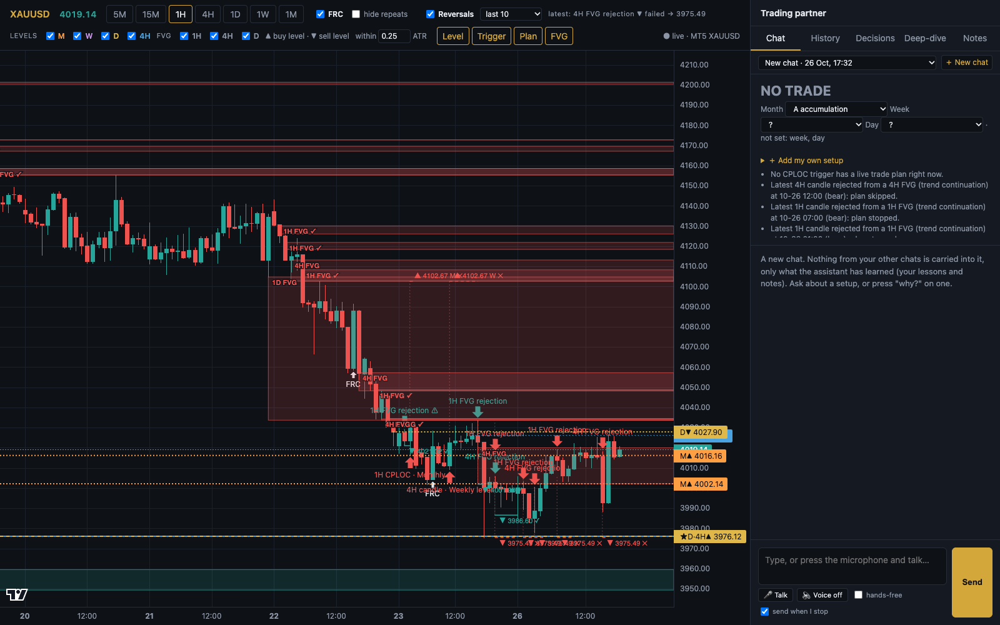
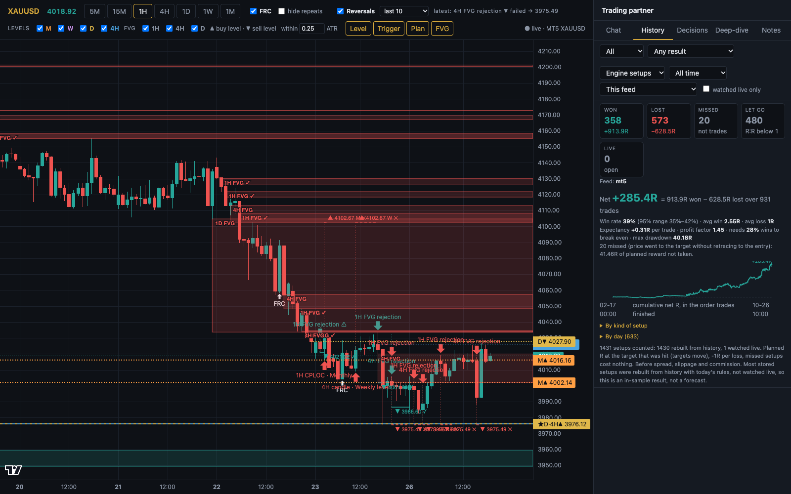
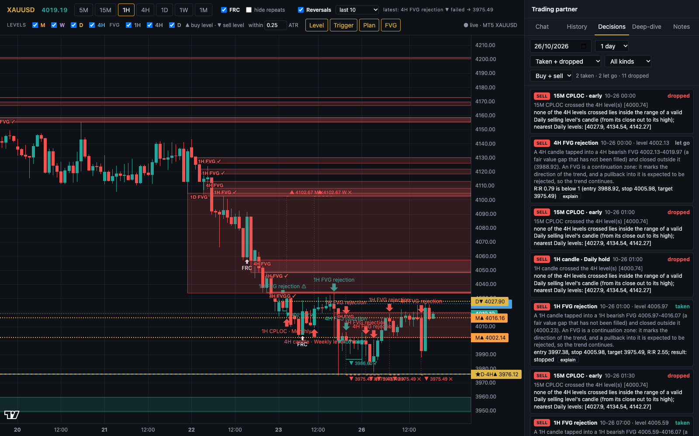
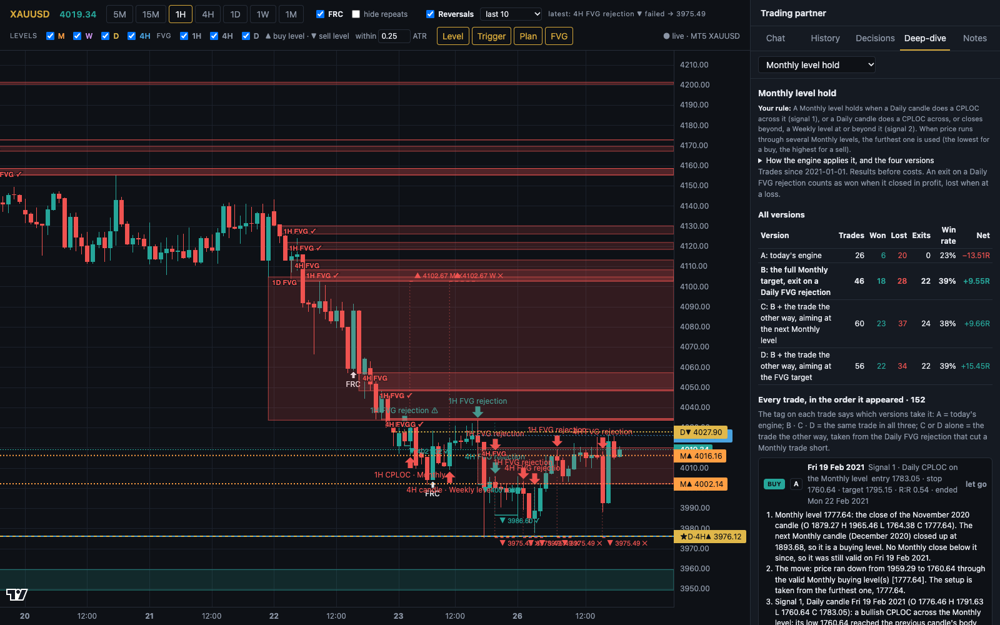
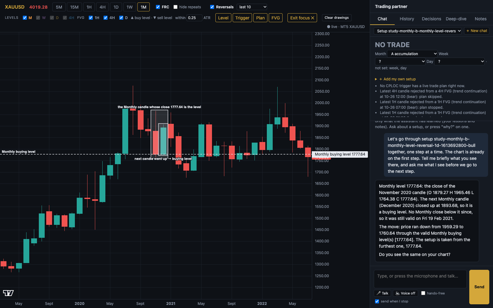
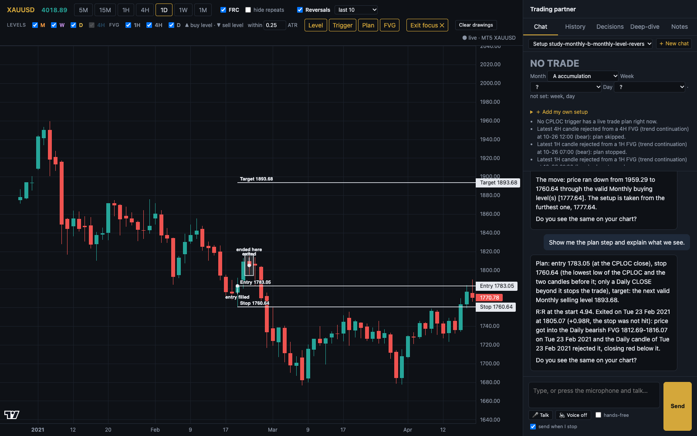
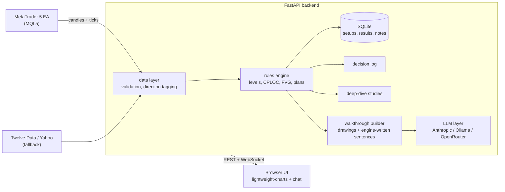

# Gold Trading Partner

A personal research tool for trading gold (XAUUSD): a **deterministic rules engine** finds trade setups on a live price chart, and an **LLM assistant explains them step by step on the chart**, using only numbers the engine computed.

It never places a trade. It exists to turn a discretionary trading strategy into explicit, testable rules, and to make every decision the engine takes (or refuses to take) inspectable.



## What it does

- **Finds setups from written rules.** Support/resistance "levels" from higher-timeframe candle closes, CPLOC reversal candles, and Fair Value Gap (FVG) continuation trades, across Daily, Weekly and Monthly tiers. Each setup gets an entry, a stop, a target and a tracked outcome in R multiples.
- **Explains why.** The assistant walks through a setup one step at a time (the level, the trigger candle, the plan), moves the chart to the right timeframe and draws each thing on it as it is mentioned.
- **Logs every decision.** For each candidate the engine looked at, it records whether it was **taken, let go, or dropped, and the reason** (for example: a Monthly breaker block left no target, a higher-timeframe FVG setup was running the other way, the level had been busted).
- **Backtests its own rules.** Setups are stored with their results; the History tab reports win rate (with a 95% range), expectancy, profit factor, drawdown and an equity curve, per kind of setup.
- **Compares rule variants.** The Deep-dive tab studies one rule at a time (currently the Monthly level hold) and lists every trade with an engine-written explanation, side by side across variants of the exit rule.
- **Runs on the broker's data.** A small MetaTrader 5 Expert Advisor streams the exact candles and ticks from the broker, so the app sees what the trader's own chart sees.

## Screenshots

| | |
|---|---|
|  **History**: every stored setup and its result, with performance statistics and the engine's reason on each row. |  **Decisions**: every candidate for a chosen day, taken or dropped, with the engine's own reason. |
|  **Deep-dive**: one rule studied trade by trade, with variants compared. |  **Walkthrough**: the assistant moves the chart to the Monthly timeframe and boxes the candle that made the level. |
|  **Plan step**: entry, stop, target and how the trade ended, drawn on the chart. | |

## How it is built



**Stack:** Python, FastAPI, uvicorn, SQLite, WebSockets, vanilla JavaScript with TradingView's `lightweight-charts` (custom series primitives for the drawings), MQL5 for the data feed, and a pluggable LLM backend (Anthropic API, a local model through Ollama, or OpenRouter).

### Design decisions worth knowing about

- **The LLM never decides anything.** Levels, signals, entries, stops, targets and results come from deterministic Python. The model is given the relevant facts for the step being discussed and told to use only those numbers. For the Deep-dive trades the app goes further and says the engine's own sentences word for word, with no model in between, because a small local model would still invent details.
- **Everything is explainable.** Every setup stores its evidence; every dropped candidate stores its reason. "Why wasn't this trade taken?" is answered from the log, not by guessing.
- **No hindsight.** Levels, targets and blocking rules are evaluated as they stood at each candle's close, so history can be replayed honestly.
- **Rules are versioned.** When a rule changes, the engine bumps a rules version; results made under the old rules are archived and the history is rebuilt, so statistics never mix two rule sets.
- **Rule changes are measured before they are switched on.** `test_wickfix.py` runs the whole engine with and without a change (in separate processes, behind environment switches) and compares setups added, setups removed, win rate and net R. A change that made results worse (letting a candle close back inside a gap without cancelling the setup) was tested and left out.
- **The rules are written down in plain English** in [`RULES.md`](RULES.md), next to the code that applies them. Rules that are agreed but not yet implemented live in [`PENDING_RULES.md`](PENDING_RULES.md), tagged R101, R102, and so on.
- **Fast enough to iterate on.** The full engine (about 1,400 setups over several years of 1H, 4H, Daily, Weekly and Monthly candles) rebuilds in a few seconds; higher-timeframe FVG legs are precomputed instead of rescanned per setup.

## The strategy, in short

The full rules are in [`RULES.md`](RULES.md). In outline:

1. **Levels** are higher-timeframe candle closes. A close is a *buying* level if the next candle went up, a *selling* level if it went down; a level is broken once a later candle closes beyond it.
2. **Signals** are a CPLOC candle (a candle that reaches the previous candle's body and closes beyond it) across a level, or a candle that closes beyond a lower-timeframe level inside the higher-timeframe candle's range. Monthly levels use Daily candles, Weekly levels 4H, Daily levels 1H.
3. **FVG trades** are trend continuations: a gap formed in the direction of the trend is tapped and rejected on its own timeframe, and the target is the peak the pullback came from.
4. **Blocking:** a trade is not taken while a higher-timeframe FVG setup is running the other way, and a level that fails (an opposite CPLOC takes the stop) is abandoned.
5. **Plans** are an entry, a stop, a target and an R:R judged once at the start; below 1 the trade is let go.

## Run it

```bash
python3 -m venv .venv && .venv/bin/pip install -r backend/requirements.txt
cp .env.example .env          # add an LLM key, or point it at a local Ollama model
python run.py                 # http://localhost:8000  (restarts itself when code changes)
python run.py restart         # stop whatever is on the port, then start
```

Choose the model in `.env`:

```
LLM_PROVIDER=anthropic         # or: ollama (local, e.g. gpt-oss:20b) | openrouter
ANTHROPIC_API_KEY=...          # only for anthropic
```

API keys stay in `.env`, which is git-ignored.

### Live broker data (MetaTrader 5)

MT5 has no public data API, so an Expert Advisor inside the desktop terminal pushes candles (5m up to monthly) and ticks to the app.

1. Copy `mt5/TradingAssistantFeed.mq5` to MT5's `MQL5/Experts` folder, open it in MetaEditor and compile.
2. In MT5: Tools, Options, Expert Advisors: allow WebRequest for `http://127.0.0.1:8000`.
3. Attach the EA to an XAUUSD chart. The app switches to the MT5 feed by itself.

Without MT5 the app falls back to Twelve Data (needs `TWELVE_DATA_API_KEY`) or Yahoo.

## Repository layout

```
backend/app/
  reversals.py      the rules engine: level tiers, CPLOC signals, FVG trades, plans, decision log
  fvg.py            fair value gaps: zones, unfilled part, rejections, higher-timeframe legs and blocking
  levels.py         level validity, polarity, user-marked levels
  frc_levels.py     CPLOC candles that cross a valid level
  patterns.py       CPLOC and break-of-structure detection (follows indicator.pine)
  study.py          Deep-dive studies: variants of one rule, every trade explained
  recommendation.py live headline (buy / sell / no trade) and the trade list
  assistant.py      tools for the LLM and the step-by-step chart walkthrough builder
  llm.py            provider-agnostic streaming chat, prompt, prompt caching
  store.py          SQLite: setups, results, performance, notes, chat sessions
  data.py, mt5.py, ticks.py   candle and tick feeds
  main.py           FastAPI routes, chat orchestration
frontend/index.html chart, tabs, drawing layer, speech
mt5/                MQL5 Expert Advisor
indicator.pine      the TradingView indicator the FVG and BOS logic follows
RULES.md            the rules in plain English
```

## Honest limits

- **Results are in-sample and before costs.** The rules were refined against the same history they are measured on, with no spread, slippage or commission. The History tab says so; treat the numbers as a development aid, not a forecast.
- **Single user, local.** No authentication, one SQLite file.
- **Not financial advice.** The tool never executes trades and is not a recommendation to trade.
- **Known data issue:** the MT5 server builds 4H candles on its own clock, which is two hours off a UTC-aligned chart. 1H and higher timeframes match.

## What I would do next

- Rebuild the 4H candles from 1H data on a UTC-aligned clock so every timeframe matches the chart exactly.
- Hold out part of the history for out-of-sample checks of each rule change.
- Add an automated test suite around the level, CPLOC and FVG functions (today they are checked by replaying known dates and by `test_wickfix.py`).
